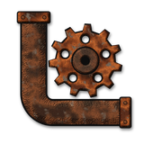
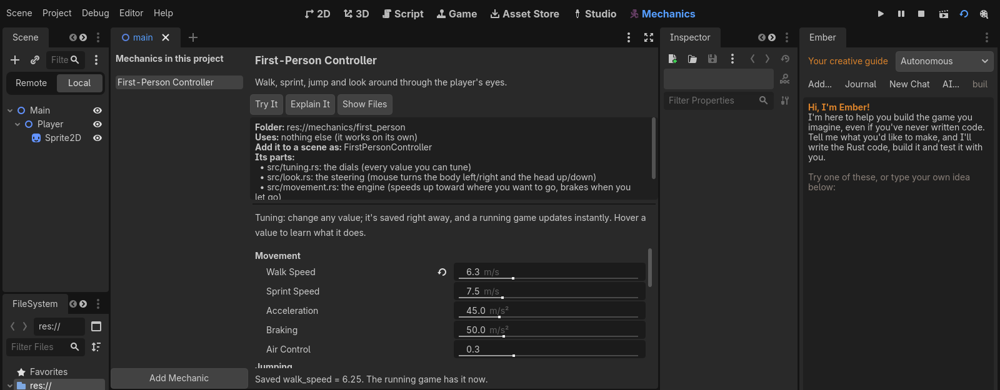
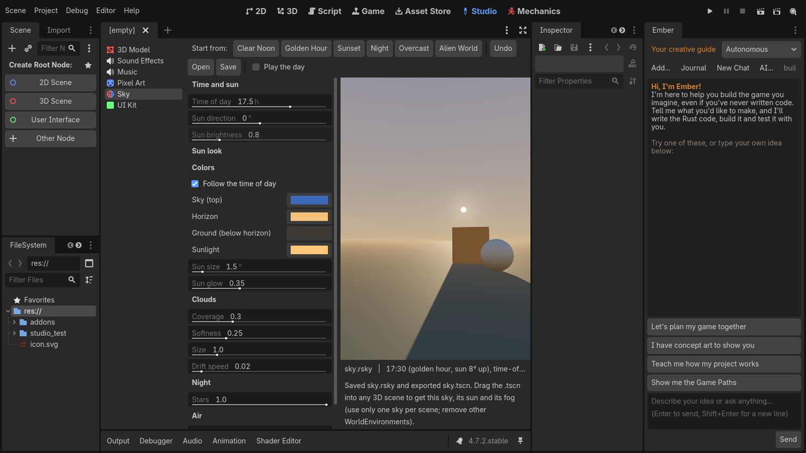
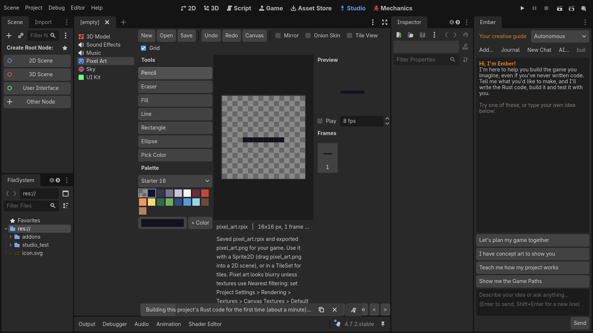
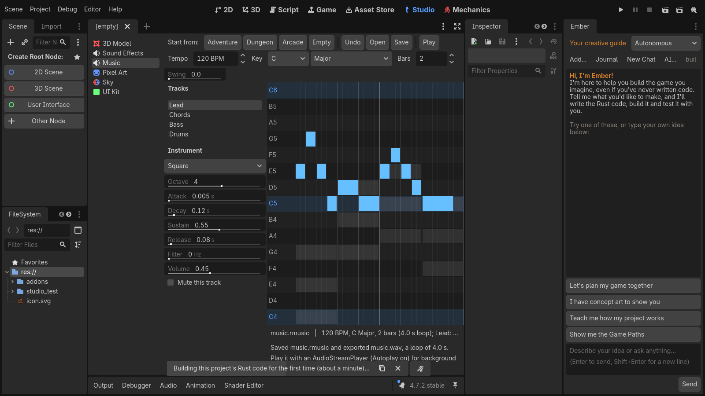

<p align="center"></p>

<h1 align="center">RusticEngine</h1>

<p align="center">A game engine where games are written in <b>Rust</b>, with <b>Ember</b>, a built-in AI partner that helps you make <i>your</i> game.<br>
Based on <a href="https://godotengine.org">Godot 4.7</a> and <a href="https://github.com/godot-rust/gdext">godot-rust</a>. Free and open source (GPL-3.0).</p>

<p align="center"><a href="https://github.com/darkdev3822/RusticEngine/releases/latest"><b>Download for Linux</b></a></p>

---

RusticEngine is for people who have always wanted to make a game and learn by making the one they imagine. Ember works *with* you, not instead of you: it asks about your idea, your inspirations and the look you're going for before it makes creative choices, it can build things for you or teach you while you build them yourself, and it encourages you to make your own art and music.



## What's inside

- **Rust by default.** New projects are Rust projects. Press Play and RusticEngine builds your code; Ember can explain any build error.
- **Ember, your AI partner.** Runs on your own computer (no account, no cloud). Two modes: *Learning* (Ember teaches as you build together) and *Autonomous* (Ember does the heavy lifting while you direct). Ember reads your code, builds and playtests it, looks at your concept art, keeps a Concept Journal of your ideas, and offers Game Paths: step-by-step routes from first idea to finished game.
- **Mechanics.** Game mechanics as self-contained parts you can add, try in their own test room, tune with sliders while the game runs, and have explained to you. Starters: first-person and third-person controllers, character stats, attacks and damage, inventory, HUD. Ask Ember for a new one (a dash, a door, checkpoints, a patrolling enemy...) and it starts from tested, working code.
- **The Studio.** Simple tools for making your own assets inside the engine: a low-poly 3D modeler, sound effects, music, pixel art, skies with time of day, and UI kits. Ember guides you through them but never makes the art for you.
- **Any AI you like.** Ember is the default, but you can switch to a cloud model (Claude, OpenAI and others) or any local GGUF model in the AI Guide settings. Agents like Claude Code, Codex and Cursor can work on your project with the same tools through MCP (Project > Tools > Connect an Outside AI Agent).
- **Export your game** for Linux, with your Rust code built in release mode.

| The Studio: Sky | The Studio: Pixel Art | The Studio: Music |
|---|---|---|
|  |  |  |

## Get started

1. Download `RusticEngine-1.0.0-linux-x86_64.tar.xz` from [Releases](https://github.com/darkdev3822/RusticEngine/releases/latest) and extract it.
2. Run `./rusticengine` (optionally `./install-desktop-entry.sh` to add it to your app menu).
3. On first start:
   - If Rust isn't installed, RusticEngine offers to install it with the official rustup installer (~250 MB, no admin password needed).
   - The first time you talk to Ember, it downloads its model ([Ember 8B](https://huggingface.co/johangdarkdev/Ember-8B-GGUF), ~5.5 GB, once).
   - The first time Ember looks at a picture, it downloads a picture-reading model (~3 GB, once).

**Requirements:** Linux x86_64. For Ember, a graphics card with 6 GB of memory or more (NVIDIA, AMD or Intel, through Vulkan) is recommended; it also runs on the CPU, slowly. NVIDIA owners can add the optional CUDA runtime from the release for extra speed. Windows and macOS are planned.

## Build from source

```sh
git clone --recursive https://github.com/darkdev3822/RusticEngine.git
cd RusticEngine

# The engine (a Godot fork: github.com/darkdev3822/rusticengine-godot)
cd engine && scons platform=linuxbsd target=editor -j$(nproc) && cd ..

# Ember's agent and its model runtime
cargo build --release --manifest-path agent/Cargo.toml
cp agent/target/release/rustic-agent engine/bin/
CARGO_TARGET_DIR=runtime/target-vulkan cargo build --release --features vulkan --manifest-path runtime/Cargo.toml
cp runtime/target-vulkan/release/ember-runtime engine/bin/

./engine/bin/godot.linuxbsd.editor.x86_64
```

You need the usual [Godot build dependencies](https://docs.godotengine.org/en/stable/contributing/development/compiling/compiling_for_linuxbsd.html), a Rust toolchain, and Vulkan headers for the runtime. `packaging/package_linux.sh` builds the release archive (export templates included).

| Folder | What's in it |
|---|---|
| `engine/` | The engine (submodule): Godot 4.7 plus `modules/rustic` (Rust projects, Ember's dock, the Studio, Mechanics) |
| `agent/` | `rustic-agent`, Ember's tools and harness (also an MCP server) |
| `runtime/` | `ember-runtime`, runs GGUF models in-process with llama.cpp (Vulkan or CUDA) |
| `training/` | How Ember was trained and is evaluated |
| `tests/` | End-to-end editor tests on a virtual screen, mechanic behavior tests |
| `packaging/` | Release packaging and Ember's model card |

## License

RusticEngine is licensed under the [GNU GPL v3](LICENSE). It builds on Godot Engine (MIT), godot-rust (MPL-2.0), llama.cpp (MIT) and Qwen3 (Apache-2.0); the release's `THIRD_PARTY.txt` lists every component and its license. The Ember model is Apache-2.0.
